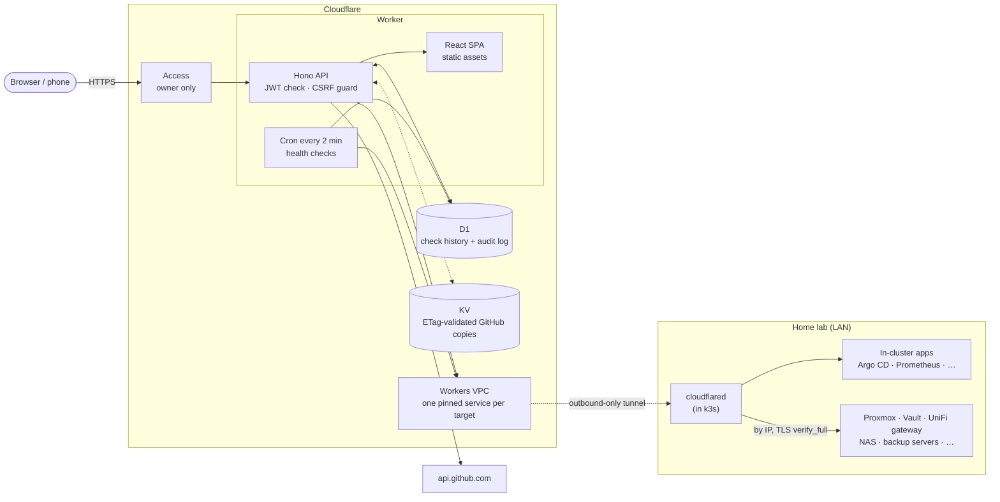

# hdctl

**A control plane for a home lab, running entirely on Cloudflare.** One page
shows whether everything in the lab is up and lets you act on it: sync Argo CD
apps, start or reboot Proxmox guests, restart UniFi devices and power-cycle PoE
ports, and run GitHub Actions workflows. Every action lands in an audit log.

A single Cloudflare Worker serves the React app and its API, Cloudflare Access
gates it, and the Worker reaches the LAN over [Workers VPC][workers-vpc]
through an outbound-only Cloudflare Tunnel. There is no inbound path into the
lab.

| Page | What it shows | What it can do |
|---|---|---|
| **Status** | Every endpoint probed live: state, latency, HTTP code; a 2-hour history strip and 24-hour uptime from checks recorded every 2 minutes. Vault nodes report active / standby / sealed | Refresh |
| **Metrics** | From Prometheus and Alertmanager: firing alerts, unhealthy workloads, per-machine CPU/RAM/disk/load, the fullest volumes, scrape targets that are down | Read only |
| **DNS** | From each Pi-hole's own API (one short login session per read, closed after): blocking on/off, queries, blocked and clients over the last 24 hours. A Pi-hole that fails shows its error and no numbers | Read only |
| **Argo CD** | Every Application's health, sync state and last operation | Refresh, sync (never prunes) |
| **Proxmox** | Each host's CPU/RAM/uptime and every VM and container | Start, shut down, reboot |
| **UniFi** | From the UniFi gateway's own Network API: WAN health, latency and speed test; every gateway, switch and access point with firmware, clients and PoE ports; every connected client | Restart a device, flash its LED, power-cycle a PoE port, reconnect a Wi-Fi client, run a speed test |
| **Uptime** | Pushed live from Uptime Kuma's own API as Kuma checks: every monitor's status, last 60 checks, response time, 24 h and 30 d uptime, certificate expiry, and recent status changes, problems first. The Status page opens with a summary | Read only |
| **Actions** | Recent runs and every active workflow, from GitHub Actions (every repository the GitHub account owns) and Gitea Actions (every repository on the Gitea instance), side by side | Run any `workflow_dispatch` workflow, with a form built from its inputs |
| **Pull requests** | Every open pull request on GitHub (the account's repositories) and Gitea, with checks, conflicts, drafts and reviews | Merge (the repository's own method, pinned to the head commit shown), close |
| **Audit** | Every action above: who, what, when, outcome | Read only |

> hdctl is built for one specific home lab, and its config (hostnames, IPs,
> repositories) is that lab's. It's published as a working reference for this
> kind of setup rather than a turnkey product, but it's structured so you can
> fork it and point it at your own systems.

## Design principles

- **Data comes from each system's own API, live.** The Proxmox page asks each
  Proxmox host, the UniFi page asks the gateway, the Argo page asks Argo CD.
  Never an exporter or another tool's copy of the data. Prometheus is the
  source only for what it is the system of record for: alerts and metrics.
- **Nothing shown is stale.** If a source fails, that section shows its error
  and no data; there is no fallback to a cached copy. The one cache (GitHub
  responses in KV) is used only when GitHub answers `304 Not Modified` to its
  ETag, i.e. when GitHub has just confirmed it's current.
- **Every target is pinned.** Each LAN endpoint is its own Workers VPC Service
  locked to one `host:port`, so even a compromised Worker can reach those
  endpoints and nothing else. Off-cluster targets are pinned by IP and don't
  depend on internal DNS.
- **TLS is always verified.** Every HTTPS hop uses `verify_full`. A device with
  only a self-signed certificate gets one Workers VPC trusts (e.g. Cloudflare
  Origin CA) instead of turning verification off.
- **Actions are narrow and audited.** Each integration exposes a small set of
  validated operations (no deletes, no config changes, no prune), and every
  action is written to the audit log before it runs and finished after.

## Architecture



- **One Worker, not Pages plus a Worker.** The SPA is served as Workers static
  assets with `run_worker_first = true`, so every request, assets included,
  goes through the Worker's own Access JWT check. `workers.dev` and preview
  URLs are off, so the custom domain behind Access is the only way in.
- **D1 holds only what no backend can give back:** health-check history and
  the audit log.
- **What depends on the cluster:** the tunnel's connector runs in k3s. If the
  cluster is down, hdctl still loads and shows everything as down. A second
  connector on a non-cluster host would keep Proxmox control during an outage.
- **Cost:** it fits comfortably within the Workers Paid plan's included usage.
  Workers bill CPU time, not wall time, so slow backends cost nothing.

## Security

| Layer | What it does |
|---|---|
| Cloudflare Access | Owner-only policy with 24 h sessions |
| Worker verifies the JWT itself | RS256 against Access's JWKS, plus `aud`, `iss`, expiry and an email allowlist, on every request including assets |
| CSRF | State-changing calls need an `X-Hdctl` header and a same-origin `Origin` |
| Pinned VPC Services | One `host:port` per target, no VPC Network binding, TLS `verify_full` |
| Narrow actions | Argo: sync without prune, via an account limited to get + sync. Proxmox: start / shutdown / reboot only. GitHub: allowlisted repos, `workflow_dispatch` only, inputs checked against the workflow's definition. UniFi: restart, locate, PoE cycle, Wi-Fi reconnect and speed test only, each checked against what the gateway reports first |
| Audit | Every action recorded before it runs |
| Secrets | Kept in Vault and synced to Worker secrets at deploy; never in git |
| Headers | CSP `default-src 'self'`, `frame-ancestors 'none'`, `nosniff`, `no-referrer` |

## Repository layout

```
infra/
  targets.json        every LAN endpoint + its VPC Service (source of truth)
  vpc-sync.mjs        creates missing VPC Services, regenerates wrangler bindings
worker/
  wrangler.toml       Worker config: domain, assets, cron, D1, KV, VPC bindings
  migrations/         D1 schema
  src/
    index.ts          routes, Access check, CSRF guard, cron entry
    auth.ts           Access JWT verification
    health.ts         live probes, classification, recorded history
    cache.ts          KV cache that only serves origin-confirmed (304) copies
    audit.ts          audited() wrapper + audit log reads
    integrations/     argo · proxmox · unifi · kuma · github · gitea · prometheus
  test/               vitest against fake upstreams
client/
  src/pages/          Status · Metrics · Argo · Proxmox · UniFi · Uptime · Actions · Pull requests · Audit
  test/               vitest + jsdom
```

## Running your own

To adapt hdctl to another lab:

1. **Targets.** Replace `infra/targets.json` with your own endpoints (address,
   TLS hostname, health check). With a Cloudflare token that has Connectivity
   Directory Admin, `npm run vpc:sync` creates a Workers VPC Service for each
   and regenerates the bindings in `worker/wrangler.toml`. `npm run vpc:check`
   (run in CI) fails if the two disagree.
2. **Worker config.** In `worker/wrangler.toml`, set your domain, your Access
   application's AUD (`CF_ACCESS_AUD`), team domain (`CF_ACCESS_TEAM_DOMAIN`) and `ALLOWED_EMAILS`, and
   the GitHub account in `GITHUB_OWNER` (the Actions page shows all of its repositories).
3. **Secrets.** Each integration reads its own credential:
   `ARGOCD_TOKEN`, `PVE_TOKENS` (JSON map of host to Proxmox API token),
   `GITHUB_TOKEN`, `GITEA_TOKEN`, `UNIFI_API_KEY`, `KUMA_TOKEN` (an Uptime Kuma login token),
   `PIHOLE_PASSWORDS` (JSON map of Pi-hole target id to a Pi-hole app password, which logs in without TOTP;
   the deploy reads them from Vault `kv/github/hdctl/pihole`, a copy of `kv/kubernetes/pihole-proxy/pihole-exporter` with the same keys,
   so changing a Pi-hole app password means updating both entries). A page whose secret is missing says
   "Not set up yet" rather than failing.
4. **Deploy** with `wrangler deploy`, after creating the D1 database and KV
   namespace and applying migrations. `.github/workflows/deploy.yml` shows how
   this repo does it from CI, with secrets pulled from Vault.

## Local development

```bash
npm install
npm run build                       # client → client/dist (the Worker serves it)
npm run db:migrate:local -w worker  # local D1
```

Put dev secrets in `worker/.dev.vars` (git-ignored):

```dotenv
DEV_MODE=true
PVE_TOKENS='{"pve":"USER@REALM!TOKENID=SECRET"}'
GITHUB_TOKEN=…
ARGOCD_TOKEN=…
UNIFI_API_KEY=…
KUMA_TOKEN=…
GITEA_TOKEN=…
PIHOLE_PASSWORDS='{"dns7":"<app password>"}'
```

Then run with a Cloudflare token that can bind VPC Services (the bindings are
`remote = true`, so local dev reaches the real LAN through the tunnel):

```bash
CLOUDFLARE_API_TOKEN=… npm run dev -w worker   # http://localhost:8787
npm run dev:client                             # optional: Vite hot reload on :5173
```

`DEV_MODE` skips the Access check only for requests to `localhost`, so it does
nothing in production even if set.

## Tests

```bash
npm test            # worker and client, no network or credentials
npm run typecheck
```

The worker tests run the real Worker in-process against SQLite with the real
migrations, with a fake upstream per target that records every call. They pin
down that nothing is served without a valid Access token, that state-changing
calls without the CSRF header are refused before anything is sent, that every
page reads its source live and shows an error rather than old data when it
fails, that the KV cache answers only after GitHub's 304, and that every
action is validated, narrow and audited. The client tests cover polling (a
failed refresh clears the data, stale data is withheld, polling pauses after
15 minutes without input and resumes with a fresh load) and reloading after a
deploy.

[workers-vpc]: https://developers.cloudflare.com/workers-vpc/
