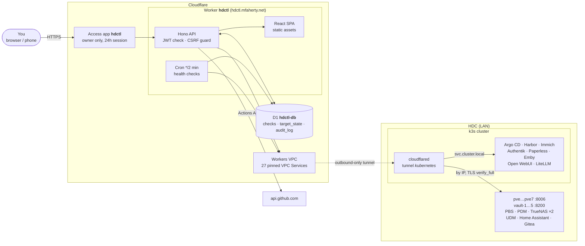
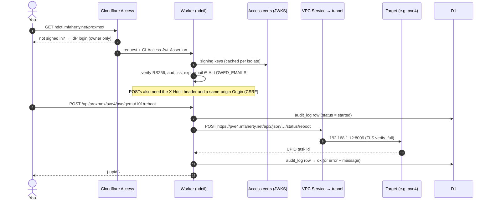
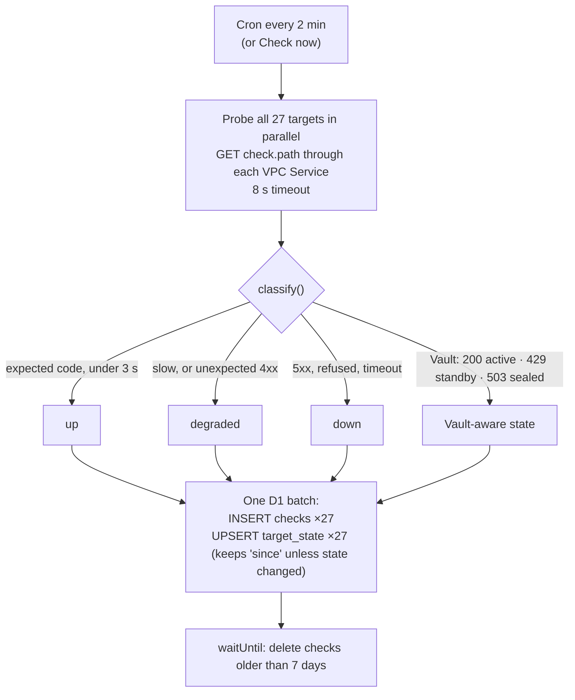
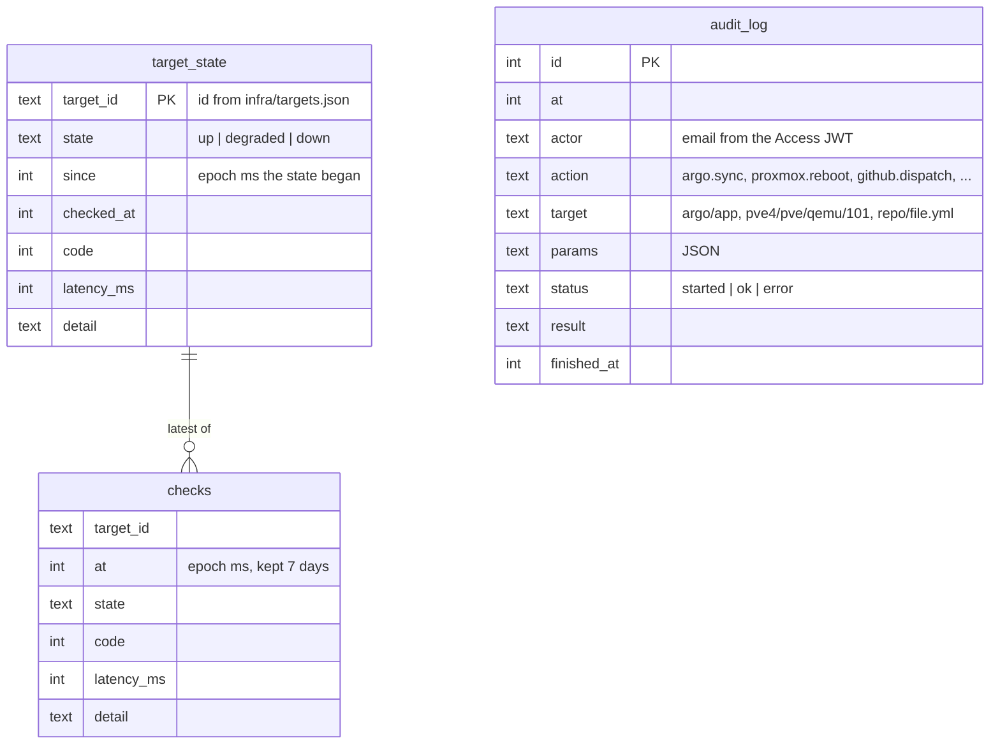
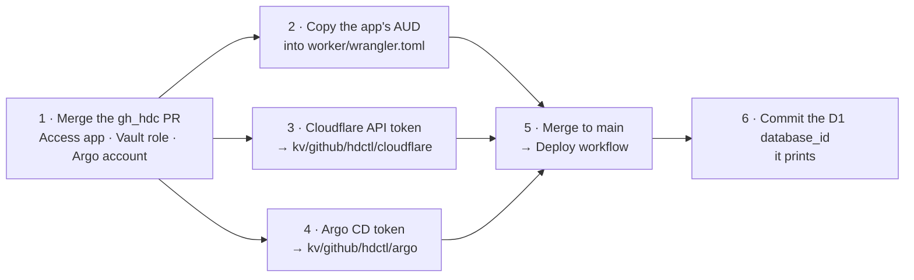
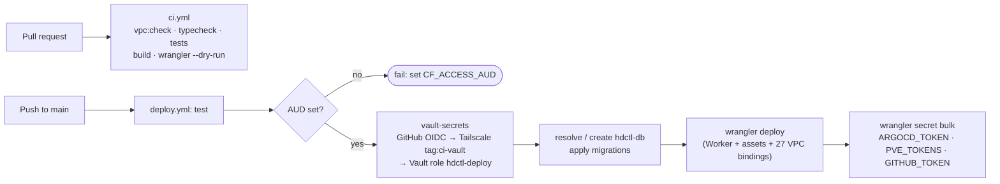

# hdctl

**The control plane for the HDC (home data center).** One page that shows
whether everything in the lab is up, and lets you act on it: sync Argo CD
apps, start or reboot Proxmox guests, and run GitHub Actions workflows. Every
action lands in an audit log.

It runs entirely on Cloudflare: a single Worker serves the React app and its
API, D1 stores health history and the audit log, and Cloudflare Access gates
it. The Worker reaches the LAN privately over Workers VPC through the existing
`kubernetes` Cloudflare Tunnel, with **no inbound path into the homelab** and
**no dependency on the cluster gateway or internal DNS** for anything that
isn't itself in the cluster.

<p>
  
  
</p>

| Panel | What it shows | What it can do |
|---|---|---|
| **Status** | 27 endpoints probed every 2 minutes: state, latency, 2-hour history strip, 24-hour uptime. Vault nodes report active / standby / sealed | Check now |
| **Argo CD** | Every Application's health, sync, and last operation | Refresh (normal or hard), Sync (never prunes) |
| **Proxmox** | All 7 standalone hosts: node CPU/RAM/uptime and every VM and CT | Start, shut down, reboot (ACPI; no hard stop) |
| **Actions** | Recent runs across `gh_hdc` and `public-jobs`, and every active workflow | Run any `workflow_dispatch` workflow, with a form built from its own inputs |
| **Audit** | Every action above: who, what, when, outcome | Read only |

---

## Architecture



**One Worker, not Pages + a Worker.** The SPA is served as Workers static
assets with `run_worker_first = true`, so *every* request, assets included,
goes through the Worker's Access check. `workers_dev` and `preview_urls` are
off, so the only way in is `hdctl.mfaherty.net`, behind the Access app.

**Pinned VPC Services, not a VPC Network binding.** Each target is its own VPC
Service locked to one `host:port`. Even a compromised Worker could reach those
27 endpoints and nothing else on the LAN. Off-cluster targets are pinned **by
IP**, so they need neither the gateway nor Pi-hole/CoreDNS. HTTPS hops use
`verify_full`: cloudflared connects to the IP and checks the certificate
against the name in the URL (the SNI), e.g. `pve4.mfaherty.net` at
`192.168.1.12`. Nothing turns certificate verification off. The UDM's HTTPS
port only has a self-signed `unifi.local` certificate, so its check is plain
HTTP on port 80 (its redirect to HTTPS is the liveness signal) and no
credentials go there.

**What still depends on the cluster.** The tunnel's connectors are the
in-cluster `cloudflared` Deployment. If k3s is down, hdctl still loads and
shows everything as down. To keep Proxmox control during a cluster outage,
add a second connector for the `kubernetes` tunnel on a non-k3s host;
the VPC Services don't change.

### Why D1, and is the latency OK?

Yes. The Worker talks to D1 through a binding, not the REST API, and the
database's primary is in Eastern North America (`--location enam`), next to the
tunnel's BOS/EWR connectors. Each page is **one** D1 round trip
(`DB.batch()`), and a health-check run writes all 54 rows in one batch.
Measured through `wrangler dev`, a full 27-target check pass, including the
D1 writes, took 0.56 s, and nearly all of that is the tunnel hop to the LAN,
not D1.

---

## Request path



## Health checks



A full day is about 19.5k check rows. Seven days of history is roughly 136k
rows, well inside D1's limits.

## Data model



---

## Security model

| Layer | What it does |
|---|---|
| Cloudflare Access app `hdctl` | Owner-only policy, 24 h sessions (shorter than Tasks' 720 h because this app can act on infrastructure). Managed in gh_hdc `terraform/cloudflare-access/apps.tf` |
| No bypass routes | `workers_dev = false`, `preview_urls = false`, custom domain only |
| Worker verifies the JWT itself | RS256 against Access's JWKS, `aud` = the app's AUD, `iss` = the team domain, expiry, and email ∈ `ALLOWED_EMAILS`. Assets included (`run_worker_first`) |
| CSRF | State-changing calls need `X-Hdctl: 1` and a same-origin `Origin`; a cross-site page can't send that header without a CORS preflight, which is never approved |
| Pinned VPC Services | 27 `host:port` pins; no VPC Network binding; TLS `verify_full` everywhere it's HTTPS |
| Narrow actions | Argo: account `hdctl` with RBAC `applications, get` + `sync` only; sync never prunes. Proxmox: start / shutdown / reboot only, validated host + node + type + vmid. GitHub: only repos in `GITHUB_REPOS`, only workflows with `workflow_dispatch`, inputs checked against the workflow's own definition |
| Audit | Every action is written to D1 *before* it runs and finished after |
| Secrets | Only in Vault; synced to Worker secrets by the deploy workflow; never in git |
| Headers | CSP `default-src 'self'`, `frame-ancestors 'none'`, `nosniff`, `no-referrer` |

---

## One-time setup



1. **Merge the gh_hdc PR.** It adds the Access app `hdctl`
   (`terraform/cloudflare-access/apps.tf`), the Vault policy and GitHub role
   `hdctl-deploy` (`vault/`), and the Argo CD local account `hdctl` with its
   RBAC (`argo/helm/values.yaml`). Their workflows apply each part on merge.
2. **AUD tag.** The Cloudflare Access workflow prints each app's AUD in its
   job summary. Put hdctl's into `CF_ACCESS_AUD` in `worker/wrangler.toml`
   (the deploy refuses to run while it's the placeholder).
3. **Cloudflare API token** (account-owned) with:
   - Account › **Workers Scripts** › Edit (the very first deploy creates the
     Worker, which needs Workers Admin)
   - Account › **D1** › Edit
   - Account › **Connectivity Directory** › Bind
   - Zone `mfaherty.net` › **Workers Routes** › Edit (for the custom domain)

   ```bash
   vault kv put kv/github/hdctl/cloudflare CLOUDFLARE_API_TOKEN=…
   ```
4. **Argo CD token** for the `hdctl` account, once `deploy-argo-cd` has
   applied the values:
   ```bash
   argocd login argo.mfaherty.net --sso
   vault kv put kv/github/hdctl/argo ARGOCD_TOKEN="$(argocd account generate-token --account hdctl)"
   ```
5. **Merge to `main`.** `deploy.yml` builds, creates `hdctl-db` if it doesn't
   exist, applies migrations, deploys, and syncs the secrets.
6. **Commit the D1 id** the deploy prints as a notice
   (`database_id = "…"` under `database_name` in `worker/wrangler.toml`).

## Deploy pipeline



The Vault role `hdctl-deploy` reads `kv/github/hdctl/*`, `kv/ci/proxmox` and
`kv/ci/github`, and only from `deploy.yml` on `main`. Rotating any credential
means updating Vault and re-running the workflow.

---

## Targets

`infra/targets.json` is the single list of everything hdctl can reach. Each
entry gives the address cloudflared connects to (`ipv4` or in-cluster
`hostname`), the `host` used for Host/SNI, the health `check`, and its VPC
Service.

| Group | Targets | Reached at |
|---|---|---|
| Proxmox hosts | pve, pve2 … pve7 | `192.168.1.x:8006`, TLS for `pveN.mfaherty.net` |
| Vault | vault-1 … vault-5 | `192.168.1.x:8200`, TLS for `vault-N.mfaherty.net` |
| Backup | PBS, PDM | `.37:8007`, `.89:8443`, Let's Encrypt certificates |
| Storage | truenas1, truenas2 | `.108:443`, `.85:443` |
| Network | UDM | `192.168.1.1:80` (redirect = alive) |
| Apps (off-cluster) | Home Assistant, Gitea | `192.168.5.169:8123`, `192.168.9.3:3000` |
| Cluster apps | Argo CD, Harbor, Immich, Authentik, Paperless, Emby, Open WebUI, LiteLLM | `*.svc.cluster.local` |

Argo CD's and Gitea's VPC Services are shared with gh_hdc's `argo-webhook` and
`ci-logs` Workers.

**Adding a target:** add a line to `infra/targets.json`, then, with a token
that has Connectivity Directory **Admin** (gh_hdc's
`GH_HDC_CF_WORKER_CONNECTIVITY_ADMIN`):

```bash
npm run vpc:sync
```

It creates the VPC Service (matching by name first, so re-runs adopt rather
than duplicate), writes its id back into `targets.json`, and regenerates the
`[[vpc_services]]` block in `worker/wrangler.toml`. Commit both. CI's
`vpc:check` fails if the two ever disagree.

---

## Repository layout

```
infra/
  targets.json        every LAN endpoint + its VPC Service (source of truth)
  vpc-sync.mjs        creates missing VPC Services, regenerates wrangler bindings
worker/
  wrangler.toml       Worker config: custom domain, assets, cron, D1, VPC bindings
  migrations/         D1 schema
  src/
    index.ts          routes, Access check, CSRF guard, cron entry
    auth.ts           Access JWT verification
    health.ts         probes, classification, status summary
    audit.ts          audited() wrapper + audit log reads
    targets.ts        target catalog + VPC fetch helper
    integrations/     argo.ts · proxmox.ts · github.ts
  test/               vitest: JWT verification, classification, input parsing, validation
client/
  src/pages/          Status · Argo · Proxmox · Actions · Audit
  src/components/     pills, meters, confirm dialog
.github/workflows/    ci.yml (PRs) · deploy.yml (main)
```

## Local development

```bash
npm install
npm run build                       # client → client/dist (the Worker serves it)
npm run db:migrate:local -w worker  # local D1
```

Put dev secrets in `worker/.dev.vars` (git-ignored):

```dotenv
DEV_MODE=true
PVE_TOKENS='{"pve":"USER@REALM!TOKENID=SECRET", "pve2": "…"}'
GITHUB_TOKEN=…
ARGOCD_TOKEN=…
```

Then run with a token that can bind VPC Services (the VPC bindings are
`remote = true`, so local dev reaches the real LAN through the tunnel):

```bash
CLOUDFLARE_API_TOKEN=… npm run dev -w worker   # http://localhost:8787
npm run dev:client                             # optional: Vite hot reload on :5173, /api → :8787
```

`DEV_MODE` skips the Access check **only** for requests to `localhost`; the
dev script passes `--local-upstream localhost` so that holds under `wrangler
dev`. In production the hostname is never `localhost`, so the flag does nothing
there even if it were set.

## Operations

| Task | How |
|---|---|
| Logs | Workers Logs in the dashboard; also exported over OTLP to Redpanda → Elasticsearch (`redpanda-logs` destination). The cron logs one line per run listing anything not up |
| Query D1 | `npx wrangler d1 execute hdctl-db --remote --command "SELECT * FROM target_state"` |
| Rotate a credential | Update it in Vault, re-run **Deploy** |
| A panel says "Not set up yet" | Its secret is empty: the message names which one and where it lives in Vault |
| Everything shows down at once | The tunnel: check `kubectl -n default get pods -l app=cloudflared`. If the cluster itself is down, that's expected (see "What still depends on the cluster") |
| Session expired | API calls fail with "reload the page to sign in again"; Access sessions last 24 h |
