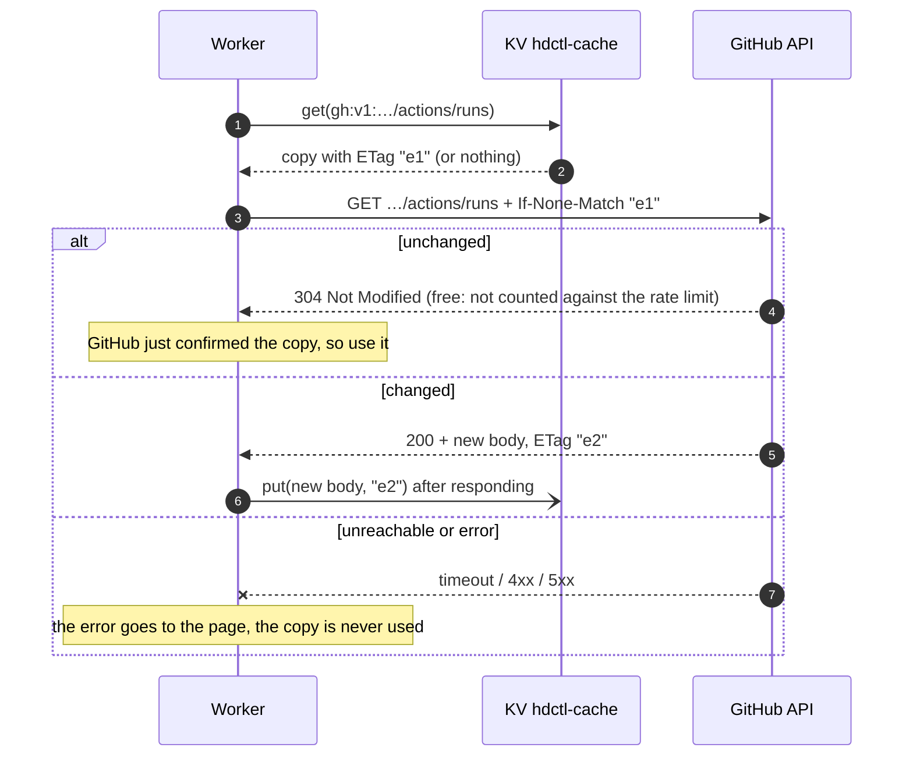
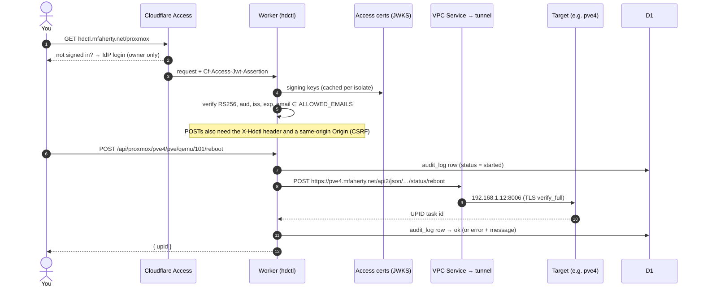
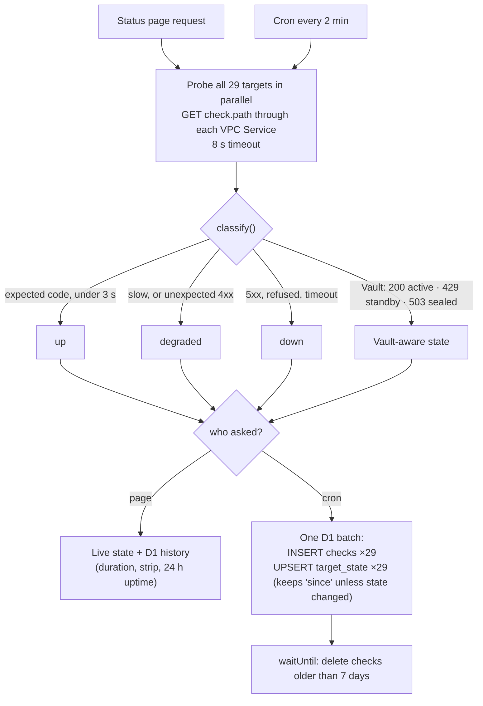
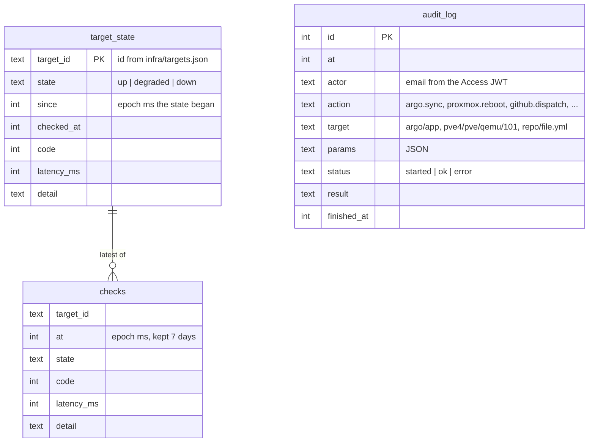

# hdctl internals

The detail behind the [README](../README.md): where each page's data comes from, how a request flows, how health checks are recorded, the data model, caching in the browser, and what it costs to run.

## Where the data comes from

**Always the system's own API.** Each panel asks the system it describes,
directly: never an exporter, a metrics pipeline or another tool's copy of the
data. The network comes from the UDM's Network API, not unpoller; Prometheus
and Alertmanager are the source only for alerts and for what exists only as
metrics. (This rule is also in `CLAUDE.md`.)

| Shown on | Source, on every request | Cached? | Kept in D1 |
|---|---|---|---|
| Status: state, latency, HTTP code | Live probe of each target through its VPC Service | No | — |
| Status: duration, history strip, 24 h uptime | D1 (recorded by the cron every 2 min) | — | `checks`, `target_state` |
| Argo CD | Argo CD API | **No**: it sends no validators, so a copy could never be confirmed | — |
| Proxmox | Each host's API (`/cluster/resources`) | **No**, same reason | — |
| UniFi | The UDM's Network API (`/proxy/network/api/s/default/stat/health`, `stat/device`, `stat/sta`), with a UniFi API key | **No**, same reason. Each of the three shows its own error if it fails | — |
| Uptime | Uptime Kuma's own Socket.IO API, with a Kuma login token: one connection, held by the `KumaLive` Durable Object only while a tab is watching, relayed to each tab over a WebSocket as Kuma pushes each heartbeat | **No.** The Durable Object keeps only what the open connection has said; when it drops, every tab shows the error and no data until a fresh snapshot arrives. A tab that hears nothing for 50 s (hdctl says "alive" every 20 s) drops its data too | — |
| Metrics | Prometheus (`/api/v1/query`, one PromQL query per section) and Alertmanager (`/api/v2/alerts`), through their own VPC Services | **No**, same reason. A section whose query fails shows its error and no data; the rest still render | — |
| GitHub runs, workflows, dispatch inputs | GitHub API | **KV, revalidated on every read** | — |
| Pull requests | GitHub: one GraphQL search (`is:pr is:open archived:false user:…`) with checks, mergeability and review. Gitea: `/repos/{repo}/pulls` and each head commit's combined status | **No** (GraphQL is a POST; Gitea isn't cached) | — |
| Gitea runs, workflows, dispatch inputs | Gitea's own API (`/api/v1`, Actions endpoints) through the `GITEA` VPC Service, with a Gitea token | **No** | — |
| Audit | D1 | — | `audit_log` |

**The KV cache is never a fallback.** Every GitHub read still goes to GitHub.
The cached copy's ETag rides along as `If-None-Match`; the copy is used only if
GitHub answers `304 Not Modified`, i.e. GitHub itself has just confirmed it is
current. If GitHub (or anything else) is unreachable or answers with an
error, that error is what you see, never the last good copy. So a backend
that is down always *shows* as down.

KV is eventually consistent (a write can take up to a minute to reach every
location). That can't make anything stale here: an older copy carries an older
ETag, so GitHub answers `200` with the current body. The worst case is a
refetch. Measured: a second load of the Actions page cost **0** rate-limit
units.

## Request path

## Health checks

The same probe runs in two places: on every Status request (live, writes
nothing) and from the cron every two minutes (recorded, for history).

A full day is about 19.5k check rows. Seven days of history is roughly 136k
rows, well inside D1's limits.

## Data model

---

## Caching in the browser

| What | How it stays current |
|---|---|
| API responses | `Cache-Control: no-store`, and every fetch uses `cache: "no-store"` |
| `index.html`, favicon | `no-cache`: revalidated on every load, so a deploy is picked up immediately |
| `/assets/*` (JS, CSS) | Content-hashed names, `immutable` for a year: changed content gets a new name, so an old file can't be served for a new one |
| An open tab after a deploy | Every response carries `X-Hdctl-Build` (the git SHA). A tab running an older bundle reloads itself, or asks first if a confirmation dialog is open |
| Back/forward navigation | A page restored from the browser's back/forward cache reloads instead of showing what it showed back then |
| Data on screen | Every page refreshes itself (every 30 s; Actions runs every 20 s) and says so: **live · as of** the time its data was fetched **· auto-refresh every 30 s**. A failed refresh clears the panel and shows the error; data older than two poll intervals (sleeping laptop, hidden tab) is withheld until a fresh answer arrives |
| A page left open | Polling stops while the tab is hidden, and after 15 minutes without input (the header says **auto-refresh paused while idle**), so a forgotten tab sends nothing to the Worker or the systems behind it. The next key press, click or scroll, or coming back to the tab, loads fresh data at once |
| Service worker | None, so there's no offline cache

---

## Why D1, and is the latency OK?

Yes. The Worker talks to D1 through a binding, not the REST API, and the
database's primary is in Eastern North America (`--location enam`), next to the
tunnel's BOS/EWR connectors. The Status page's history is **one** D1 round
trip (`DB.batch()`), run in parallel with the live probes, and a cron run
writes all 54 rows in one batch. Measured through `wrangler dev`, probing all
27 targets live took about 0.5 s, nearly all of it the tunnel hop to the LAN.

## What it costs

Nothing beyond the Workers Paid plan the account already has. Every meter
stays a small fraction of what that plan includes:

- **Slow backends cost nothing.** Workers bill CPU time, not wall time: waiting
  on a slow target, the tunnel or GitHub isn't billed, and neither are
  subrequests. A slow target only makes its request slower: a probe gives up
  after 8 s, an API call after 10 s.
- **Static assets are free**, Workers VPC is free during its open beta, and
  requests Access refuses never reach the Worker.

| Meter | hdctl's use | Included per month |
|---|---|---|
| Worker requests | cron 21,600 a month; a tab in use adds 2,880 a day (every 30 s), and nothing while hidden or after 15 minutes without input | 10 million |
| CPU time | a few ms a request (JWT check, JSON) | 30 million ms |
| D1 rows written | about 200 a cron run (insert + its two indexes, upsert, prune): ~4.3 million a month | 50 million |
| D1 rows read | about 21,000 a Status refresh (24 h of checks for uptime, 2 h for history): ~1.8 billion a month with a Status tab open around the clock | 25 billion |
| KV | GitHub panel only: a read per call, a write only when GitHub's answer changed | 10 million reads, 1 million writes |

It would not fit the Workers Free plan: D1 there stops at 5 million rows read
and 100,000 written a day, and the cron alone writes about 144,000.

---
