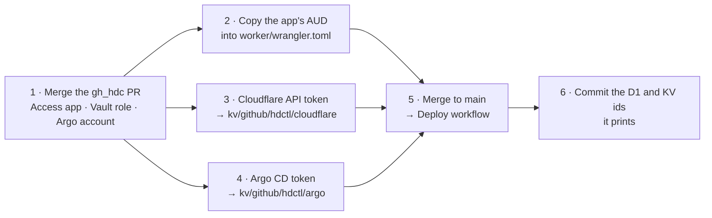
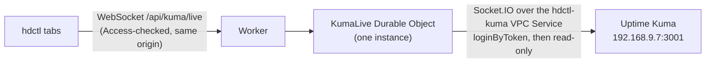
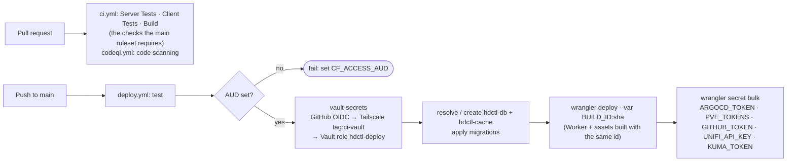

# Operating hdctl in the HDC

The runbook for this particular deployment: one-time setup, credentials in Vault, the deploy pipeline, the target list and day-to-day operations. Names, IPs and Vault paths are this lab's; adapt them if you run your own copy.

## One-time setup



1. **Merge the gh_hdc PR.** It adds the Access app `hdctl`
   (`terraform/cloudflare-access/apps.tf`), the Vault policy and GitHub role
   `hdctl-deploy` (`vault/`), and the Argo CD local account `hdctl` with its
   RBAC (`argo/helm/values.yaml`). Their workflows apply each part on merge.
2. **AUD tag.** The Cloudflare Access workflow prints each app's AUD in its
   job summary. Put hdctl's into `CF_ACCESS_AUD` in `worker/wrangler.toml`
   (the deploy refuses to run while it's the placeholder).
3. **Cloudflare API token** (account-owned) with:
   - Account › **Workers Scripts** › Edit (the very first deploy creates the
     Worker, which needs Workers Admin)
   - Account › **D1** › Edit
   - Account › **Workers KV Storage** › Edit
   - Account › **Connectivity Directory** › Bind
   - Zone `mfaherty.net` › **Workers Routes** › Edit (for the custom domain)

   ```bash
   vault kv put kv/github/hdctl/cloudflare CLOUDFLARE_API_TOKEN=…
   ```
4. **Argo CD key** for the `hdctl` account, once `deploy-argo-cd` has
   applied the values. In the Argo UI open **Settings › Accounts › hdctl**
   (https://argo.mfaherty.net/settings/accounts/hdctl), leave **Expires In**
   empty (the key then never expires) and click **Generate New**. Store it:
   ```bash
   vault kv put kv/github/hdctl/argo ARGOCD_TOKEN=…
   ```
   The deploy reads both keys in one Vault step, so it fails until this one
   exists too. To revoke the key, delete it on the same Argo page.
5. **Merge to `main`.** `deploy.yml` builds, creates `hdctl-db` and the KV
   namespace `hdctl-cache` if they don't exist, applies migrations, deploys,
   and syncs the secrets.
6. **Commit the two ids** the deploy prints as notices: `database_id = "…"`
   under `database_name`, and `id = "…"` under `binding = "CACHE"`, in
   `worker/wrangler.toml`.

### UniFi: the UDM's API

The UniFi page talks to the UDM's Network application directly. Two things
are needed once, in this order:

1. **A certificate Workers VPC can verify.** Issue a Cloudflare Origin CA
   certificate for `unifi.mfaherty.net` (SSL/TLS › Origin Server, 15 years)
   and install it as the UDM's UniFi OS certificate. Store the pair in Vault
   so it can be reinstalled after a firmware update. Then update gh_hdc's
   `kubernetes/nginx-gateway-fabric/policies/unifi-backend-tls.yaml` in the
   same change: its `BackendTLSPolicy` validates `unifi.local` against the old
   self-signed CA, so the browser route at `unifi.mfaherty.net` breaks until
   it validates `unifi.mfaherty.net` against the Origin CA root.
2. **An API key.** In UniFi OS, add a local admin `hdctl` with only the
   Network application at *Site Admin* (the restart, PoE and reconnect
   commands need more than read-only), create an API key for it
   (*Control Plane › Integrations*), and store it:
   ```bash
   vault kv put kv/github/hdctl/unifi UNIFI_API_KEY=…
   ```
   The deploy reads it in the same Vault step as the others, so it fails
   until this exists.
3. **The VPC Service.** With a Connectivity Directory Admin token,
   `npm run vpc:sync` creates `hdctl-unifi-https` (192.168.1.1:443,
   `verify_full`) and regenerates the binding; commit both files. CI's
   `vpc:check` fails until then. The old `hdctl-unifi` service (port 80) can
   be deleted afterwards.

### Uptime: Uptime Kuma's API, live

The Uptime page and the Status page's Kuma summary are pushed live from
Kuma's Socket.IO API (the one Kuma's web UI uses) at `192.168.9.7:3001`
(plain HTTP on the LAN, like Gitea), not through `health.mfaherty.net`,
which sits behind Access.



- The Durable Object opens Kuma's connection when the first tab connects
  and closes it a minute after the last one leaves. Kuma then pushes each
  heartbeat, and tabs see it within about a second.
- If Kuma drops or goes quiet past its own ping deadline, every tab shows the
  error and no monitors; hdctl reconnects (1 s, 2 s, 4 s … 30 s) and sends a
  fresh snapshot. A refused token is retried once a minute, since Kuma
  rate-limits logins.
- Cost: a Durable Object that holds an outbound WebSocket can't hibernate, so
  it's billed for the time it's connected, which is only while hdctl is open.
  Even 24/7 it would be about 324,000 GB-s a month, inside the Workers Paid
  plan's 400,000 included (shared across the account).

1. **A login token.** Kuma 2.x accepts API keys only on `/metrics`, so the
   live API needs a login. hdctl holds the token Kuma's web UI keeps after
   you sign in, never the password: sign in at health.mfaherty.net, run
   `localStorage.getItem("token")` in the browser console, and store it:
   ```bash
   vault kv put kv/github/hdctl/kuma KUMA_TOKEN='eyJ…'
   ```
   The token doesn't expire on its own. Changing the Kuma password revokes
   it; store a new one after a password change. It can do anything the Kuma
   admin can; hdctl sends only `loginByToken` and
   `monitorImportantHeartbeatListPaged` (a test checks this).
2. **The VPC Service.** `npm run vpc:sync` creates `hdctl-kuma`
   (192.168.9.7:3001) and regenerates the binding; commit both files.

## Deploy pipeline



The Vault role `hdctl-deploy` reads `kv/github/hdctl/*`, `kv/ci/proxmox` and
`kv/ci/github`, and only from `deploy.yml` on `main`. Rotating any credential
means updating Vault and re-running the workflow.

---

## Targets

`infra/targets.json` is the single list of everything hdctl can reach. Each
entry gives the address cloudflared connects to (`ipv4` or in-cluster
`hostname`), the `host` used for Host/SNI, the health `check`, and its VPC
Service.

| Group | Targets | Reached at |
|---|---|---|
| Proxmox hosts | pve, pve2 … pve7 | `192.168.1.x:8006`, TLS for `pveN.mfaherty.net` |
| Vault | vault-1 … vault-5 | `192.168.1.x:8200`, TLS for `vault-N.mfaherty.net` |
| Backup | PBS, PDM | `.37:8007`, `.89:8443`, Let's Encrypt certificates |
| Storage | truenas1, truenas2 | `.108:443`, `.85:443` |
| Network | UDM | `192.168.1.1:443`, TLS for `unifi.mfaherty.net` (Cloudflare Origin CA certificate) |
| Apps (off-cluster) | Home Assistant, Gitea, Uptime Kuma | `192.168.5.169:8123`, `192.168.9.3:3000`, `192.168.9.7:3001` |
| Cluster apps | Argo CD, Harbor, Immich, Authentik, Paperless, Emby, Open WebUI, LiteLLM | `*.svc.cluster.local` |

Argo CD's and Gitea's VPC Services are shared with gh_hdc's `argo-webhook` and
`ci-logs` Workers.

**Adding a target:** add a line to `infra/targets.json`, then, with a token
that has Connectivity Directory **Admin** (gh_hdc's
`GH_HDC_CF_WORKER_CONNECTIVITY_ADMIN`):

```bash
npm run vpc:sync
```

It creates the VPC Service (matching by name first, so re-runs adopt rather
than duplicate), writes its id back into `targets.json`, and regenerates the
`[[vpc_services]]` block in `worker/wrangler.toml`. Commit both. CI's
`vpc:check` fails if the two ever disagree.

---

## Known gaps worth closing

Both work today, but grant more than hdctl needs:


- **Proxmox tokens are `root@pam!gha`** (`kv/ci/proxmox`, shared with the
  Terraform workflow). Create a `hdctl@pve` user per host with a token that has
  `PVEAuditor` + `VM.PowerMgmt` only, store them at `kv/github/hdctl/proxmox`,
  and point the deploy workflow there.
- **The GitHub token is the classic `repo`-scoped `GH_HDC_PAT`.** A
  fine-grained token limited to `gh_hdc`, `public-jobs` and `hdctl` with *Actions: read
  and write* and *Contents: read* is all hdctl uses.

---

## Operations

| Task | How |
|---|---|
| Logs | Workers Logs in the dashboard; also exported over OTLP to Redpanda → Elasticsearch (`redpanda-logs` destination). The cron logs one line per run listing anything not up |
| Query D1 | `npx wrangler d1 execute hdctl-db --remote --command "SELECT * FROM target_state"` |
| Empty the cache | Safe at any time (it only saves transfers): `npx wrangler kv key list --binding CACHE --remote`, then delete keys, or recreate the namespace |
| Rotate a credential | Update it in Vault, re-run **Deploy** |
| A panel says "Not set up yet" | Its secret is empty: the message names which one and where it lives in Vault |
| Everything shows down at once | The tunnel: check `kubectl -n default get pods -l app=cloudflared`. If the cluster itself is down, that's expected (see the README, "Architecture") |
| Session expired | API calls fail with "reload the page to sign in again"; Access sessions last 24 h |
